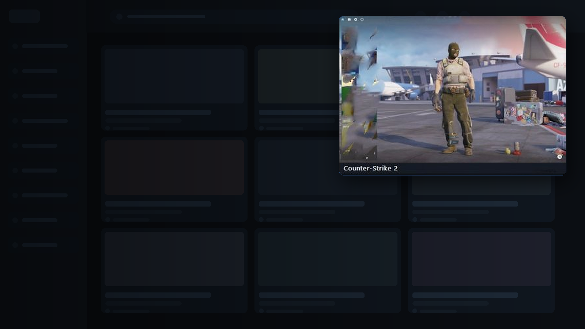
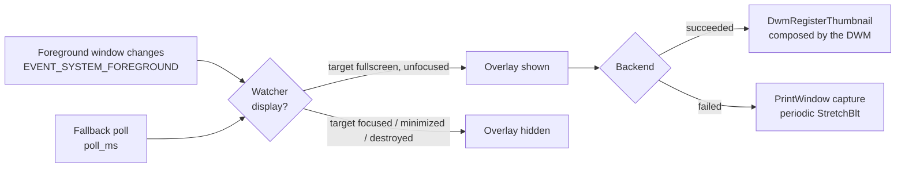

# SidePeek

[](https://github.com/markliu12/sidepeek/actions/workflows/ci.yml)

**English** · [简体中文](README.zh-CN.md)

> **Stop alt-tabbing back while you wait to respawn — the picture stays in the corner.**

SidePeek is a Windows desktop utility that displays a live thumbnail of a game window while that window is in the background, and removes the thumbnail when the game window regains focus.



*The thumbnail appears when the game loses focus, and disappears when it gets focus back.*

---

## Overview

Many multiplayer games impose a respawn delay of five to sixty seconds, during which users typically switch to another window. Standard taskbar previews require the pointer to hover over the item and may display an outdated image, so verifying whether the respawn delay has elapsed requires repeated window switching.

SidePeek removes that interaction. When the game window loses foreground status, a thumbnail of that window appears in a corner of the desktop. When the game window regains foreground status, the thumbnail is removed.

The thumbnail is a live rendering of the game window rather than a periodic screenshot or a screen recording. In the default configuration it is composed by the Desktop Window Manager, which places no measurable load on the CPU and preserves the frame rate of the game.

## Requirements

- Windows 10 or Windows 11, 64-bit
- Python 3.9 or later, for execution from source
- WinRT Python projections for OCR and notifications (bundled in the executable)

## Installation

### From source

```bash
git clone https://github.com/<user>/sidepeek.git
cd sidepeek
python run.py
```

To start without a console window, use `pythonw run.py`.

`config.json` is created in the program directory on first start, with the default values described under [Configuration](#configuration).

### From a release

`SidePeek.exe` is attached to each [release](https://github.com/markliu12/sidepeek/releases). No installation is required. Changes between versions are recorded in [CHANGELOG.md](CHANGELOG.md).

### Building the executable

```bat
build_exe.bat
```

The resulting executable is `dist\SidePeek.exe`, approximately 8 MB, and requires no Python installation. The icon and the Windows version resource are taken from `assets/sidepeek.ico` and `version_info.txt`; PyInstaller is installed automatically if it is unavailable. `config.json` is created next to the executable on first start.

Pushing a tag matching `v*` triggers `.github/workflows/build.yml`, which builds the executable, verifies that the version resource is present, and uploads it both as a workflow artifact and as a release asset.

## Behavior

### Target selection

The watched window is selected in the following order:

1. **Locked target.** A window explicitly pinned with `Ctrl+Alt+L` takes precedence for the remainder of the session.
2. **Allowlist.** If `peek.targets` is not empty, the most recently focused window whose process name matches the list is used. If no such window has been focused, the largest visible window matching the list is used.
3. **Automatic detection.** If `peek.targets` is empty, the foreground window is recorded as the target whenever it covers a monitor. If no window has been recorded, the largest visible window that covers a monitor is adopted; this allows the tool to be started after the user has already switched away from the game.

Process names listed in `peek.ignore` are never treated as games.

### Display conditions

The thumbnail is displayed only when all of the following hold:

- a target window exists and is valid;
- the target window is not the foreground window;
- the target window is visible;
- the target window is not minimized, unless `hide_when_minimized` is `false`;
- the pointer is not over the thumbnail, if `hide_when_hovered` is `true`.

A target window that has been destroyed is discarded from the internal state.

A window chosen from the **监视窗口** menu is pinned in the same way as `Ctrl+Alt+L`, and choosing **自动** releases it.

### Fullscreen detection

A window is treated as fullscreen when either of the following holds:

- it covers at least 98% of its monitor, which also covers the taskbar area; or
- it covers at least 90% of its monitor and is not maximized. Maximized windows are excluded from this rule because they fill only the work area, approximately 96% of the monitor, and would otherwise be indistinguishable from fullscreen applications.

Detection can be bypassed by specifying `peek.targets` or by locking a window with `Ctrl+Alt+L`.

### Window interaction

The thumbnail is frameless, always on top, and never activated by the pointer. It can be dragged with the left mouse button and resized by dragging the lower-right corner; both the size and the position are written to `config.json` on exit. The minimum size is 160 × 90 pixels. A single click returns focus to the game window. A right-click opens a context menu.

The width is the dimension the user controls. With `fit_aspect` enabled (the default) the height is derived from the aspect ratio of the game, so 16:9, 16:10, 21:9 and 4:3 titles all fill the picture area without black bars; the starting height of 304 corresponds to 16:9 and is corrected the first time a game is shown. Disabling `fit_aspect` freezes the window shape, in which case the picture is letterboxed to fit.

Dragging the resize handle disables `fit_aspect` automatically: a size chosen by hand must not be overridden the next time the thumbnail appears. The **按画面比例自适应** entry in either context menu turns it back on.

### Notification area

SidePeek places an icon in the notification area for as long as it runs. It remains available while the thumbnail is hidden, which makes it the reliable way to reach the program when no console window is open.

- **Right-click** opens a menu: return to the game window, open the target list, toggle the aspect fit, pause or resume monitoring, toggle run-at-login, and quit.
- The **监视窗口** submenu lists every window that can be watched, largest first. Selecting one pins it, exactly like `Ctrl+Alt+L`; selecting **自动** releases the pin and returns to automatic detection. This is the intended way to switch between several running games: no hotkey to remember, and the list shows what is available.
- **Double-click** pauses or resumes monitoring.
- The tooltip reports the current state (`SidePeek — 监视中` or `SidePeek — 已暂停`).
- **CS2 round-end notifications** are enabled by default. While CS2 is in the background, SidePeek checks the central result banner every half second and sends one Windows notification after recognizing `回合胜利` / `回合失敗` in either script. It rearms after the banner disappears, and a 10-second cooldown keeps a fading banner from notifying twice. The wording follows the banner: a simplified-Chinese client is notified in simplified Chinese, a traditional one in traditional, and `ROUND WIN` / `ROUND LOSS` in English, so the toast matches what the player just read on screen. Set `notification_language` to `zh-CN`, `zh-TW` or `en` to pin one language instead, or pick it from **提醒语言** in the tray menu. Toggle the feature from the tray menu.
- **Bark phone push** is optional. Copy the device key from Bark on your iPhone, open **手机提醒设置...** from the tray menu, paste the key, then choose **保存并测试**. Each detected CS2 result is then also sent to Bark. The key is stored in `config.json` next to SidePeek.exe; keep it private. Notifications use the SidePeek icon by default. To change it, edit `bark_icon_url` manually.

If Explorer restarts, the icon is added again automatically.

When notifications are enabled, SidePeek ensures a per-user Start Menu shortcut exists so Windows can associate notifications with the app. Recognition is text-first: the crop is upscaled 2x and read with Windows OCR, and a round counts when `回合` is followed by any result character — one misread glyph is tolerated, while the team line `反恐精英胜利` is not, since it never contains `回合`. Simplified, traditional and English clients are all covered (`ROUND WIN` / `ROUND LOSS`, any case). Any other reading, including none at all, means no round ended. The red/yellow colour check is kept only as a fallback for machines whose OCR cannot read the game's text at all, because the main menu and warm map walls are rendered scenes that colour alone cannot tell apart from a banner. If frame capture is unavailable, SidePeek logs the reason and continues running; exclusive fullscreen is not guaranteed to be capturable.

### One instance at a time

A named mutex stops a second copy from starting. Starting the program again does not open a second window and does not cost the first copy its hotkeys: the running copy shows a balloon pointing at its notification-area icon, and the new process exits with code 0. The command-line diagnostics are exempt, so `--list`, `--self-test` and `--screenshot` still work while the program is running.

## Command line

```bash
python run.py [--config PATH] [--backend {auto,dwm,capture}]
              [--width N] [--height N] [--target EXE]
              [--list] [--self-test] [--screenshot PATH]
```

| Option | Description |
| --- | --- |
| `--config PATH` | Path to the configuration file. Defaults to `config.json` in the program directory. |
| `--backend` | Forces a rendering backend. `auto` attempts `dwm` first and falls back to `capture`. |
| `--width`, `--height` | Overrides the thumbnail size for the current session. |
| `--target EXE` | Restricts monitoring to the given process name. May be repeated. |
| `--list` | Prints the visible top-level windows and exits. |
| `--self-test` | Tests both backends against a real window and exits. |
| `--screenshot PATH` | Saves a single captured frame as a PNG and exits. |

Values supplied with `--width`, `--height`, `--backend` and `--target` apply to the current session only and are not written to `config.json`.

## Hotkeys

| Hotkey | Action |
| --- | --- |
| `Ctrl+Alt+G` | Suspends or resumes monitoring. |
| `Ctrl+Alt+L` | Locks the foreground window as the target. |
| `Ctrl+Alt+Q` | Terminates the program. |

The combinations are configurable through `hotkey_toggle`, `hotkey_lock` and `hotkey_quit`. If a combination is already registered by another application, the program continues without that hotkey and says so in a notification-area balloon; the corresponding action stays available from the tray menu.

## Diagnostics

The self-test exercises both rendering backends against a window on the current desktop and reports the result of each:

```bash
python run.py --list
python run.py --self-test
python run.py --screenshot frame.png --target cs2.exe
```

Example output:

```
dwm composition : True
test target: cs2.exe | Counter-Strike 2
  window        : created
  dwm thumbnail : OK  size=(2560, 1440)
  capture       : OK  (2560, 1440) via printwindow-full
result: ready - at least one backend works on this machine
```

The self-test is the recommended diagnostic step before reporting a defect.

### Log file

The packaged build runs without a console, so everything that would be printed there is also appended to:

```
%LOCALAPPDATA%\SidePeek\sidepeek.log
```

One previous generation is kept as `sidepeek.log.1` once the file passes 512 KB. Unhandled exceptions are written to the same file and shown in a message box, so a crash in the windowed build is no longer silent. Attach this file when reporting a problem.

## Configuration

The configuration file is JSON. Missing keys fall back to the defaults; unknown keys are ignored.

| Key | Default | Description |
| --- | --- | --- |
| `width`, `height` | `492`, `304` | Thumbnail window size in physical pixels, minimum 160 × 90. The default leaves a 480 × 270 (16:9) picture area once border padding and the caption strip are subtracted, so 16:9 games are shown without black bars. |
| `backend` | `"auto"` | `auto`, `dwm` or `capture`. |
| `anchor` | `"bottom-right"` | `top-left`, `top-right`, `bottom-left`, `bottom-right` or `custom`. |
| `margin` | `24` | Distance from the monitor edge, in pixels. |
| `pos` | `[0, 0]` | Position used when `anchor` is `custom`. |
| `padding` | `6` | Space between the border and the image. |
| `opacity` | `100` | Image opacity, 10 to 100. Applies to the `dwm` backend. |
| `caption` | `true` | Displays a footer with the process name and the elapsed time in background. |
| `fit_aspect` | `true` | Derives the height from the aspect ratio of the game so the picture fills the frame. Turned off automatically when the resize handle is used. |
| `click_to_focus` | `true` | A single click returns focus to the game. |
| `hide_when_minimized` | `true` | Hides the thumbnail while the game is minimized. |
| `hide_when_hovered` | `false` | Hides the thumbnail while the pointer is over it. |
| `fps` | `20` | Frame rate of the `capture` backend, 1 to 60. |
| `targets` | `[]` | Process names to monitor, for example `["cs2.exe", "dota2.exe"]`. An empty list enables automatic detection. |
| `auto_detect_fullscreen` | `true` | Treats monitor-filling windows as games. |
| `ignore` | see file | Process names that are never treated as games. |
| `poll_ms` | `300` | Interval of the fallback poll, in milliseconds. |
| `hotkey_toggle` | `"ctrl+alt+g"` | Suspends or resumes monitoring. |
| `hotkey_lock` | `"ctrl+alt+l"` | Locks the foreground window as the target. |
| `hotkey_quit` | `"ctrl+alt+q"` | Terminates the program. |
| `show_in_taskbar` | `false` | Displays the thumbnail in the taskbar. |
| `cs2_round_notifications` | `true` | Sends one Windows notification when a CS2 round-result banner appears in the background; also sends a phone push when a Bark key is configured. |
| `notification_language` | `"auto"` | Language of that notification: `auto` follows the banner's own language, or pin it with `zh-CN`, `zh-TW` or `en`. |
| `bark_device_key` | `""` | Device key from the Bark app. Empty disables phone pushes. |
| `bark_icon_url` | SidePeek icon URL | Image URL for the Bark notification icon. Empty uses Bark's default icon. |

Hotkeys may be changed or disabled by assigning an empty string. Changes take effect after a restart.

## Architecture



The implementation is divided into the following modules:

| File | Responsibility |
| --- | --- |
| `win32.py` | `ctypes` bindings for user32, gdi32 and dwmapi, with explicit `argtypes` and `restype` for every function used. |
| `capture.py` | `PrintWindow` capture into a DIB, including validation of the resulting frame. |
| `overlay.py` | Frameless top-level window, both rendering modes, painting, drag and resize handling, context menu. |
| `watcher.py` | Target selection and the display decision. |
| `config.py` | Configuration loading, merging and write-back. |
| `app.py` | Message loop, global hotkeys, foreground event hook, diagnostics. |
| `png.py` | Minimal PNG encoder used by the diagnostics only. |
| `diag.py` | Log file and unhandled-exception handling. |
| `instance.py` | Single-instance lock and the ping sent to a running copy. |
| `autostart.py` | Run-at-login switch backed by the per-user `Run` entry. |

### Rendering backends

`dwm` registers a thumbnail with `DwmRegisterThumbnail`, the same mechanism used by the system Alt+Tab preview. The compositor renders the source window into a rectangle of the destination window on the GPU. Only the destination rectangle is updated, so no pixel data is read, copied or scaled by this process.

This backend requires the source window to be composed by the Desktop Window Manager. Exclusive fullscreen applications bypass the compositor and therefore produce an empty thumbnail.

`capture` obtains frames with `PrintWindow(PW_RENDERFULLCONTENT)`, which reads the DWM redirection surface and therefore also works for background windows. Each frame is sampled to detect an entirely black result; if the check fails, a plain `BitBlt` from the window device context is attempted. This backend consumes CPU in proportion to the configured frame rate and is used only when the `dwm` backend is unavailable.

## Testing

```bash
python -m compileall -q sidepeek run.py
python -m unittest discover -s tests -t .
python -m mypy            # type check (requires mypy)
```

The test suite uses the standard library `unittest` module and requires no additional packages. The Win32 layer is mocked, so the tests run without an interactive desktop session. Continuous integration executes the suite on Python 3.9, 3.11 and 3.13, and runs a `mypy` type check as a separate job.

## Limitations

- **Exclusive fullscreen is not supported.** When a fullscreen exclusive application loses focus, Windows minimizes its window and rendering stops; no capture mechanism can recover a live image. Fullscreen windowed or borderless windowed mode is required. This is also the recommended mode for most competitive games, as it reduces the cost of task switching.
- **Protected content is not captured.** Windows protected by DRM or HDCP produce a black image.
- **HDR content may be displayed with incorrect colours** by the `capture` backend, which reads the tone-mapped SDR surface.
- **Windows only.** The implementation depends on Win32 and the Desktop Window Manager.
- **Anti-cheat considerations.** SidePeek does not inject code into other processes and does not read or write game memory; it uses only documented window and screen-capture APIs. Policies regarding third-party software differ between games and anti-cheat systems, and compliance with the applicable terms of service is the responsibility of the user.

## Troubleshooting

**The thumbnail does not appear after switching away from the game.**
Run `python run.py --self-test`. If both backends report success, the target window was probably not recognized. Specify it with `--target` or with `peek.targets`, or press `Ctrl+Alt+L` while the game is focused.

**The thumbnail is black or frozen, typically after the machine has been asleep.**
Resuming from sleep is handled by rebuilding the thumbnail, so the frame should come back within a fraction of a second. If it does not, the source window is likely in exclusive fullscreen mode, which the `dwm` backend cannot compose. Change the game to fullscreen windowed or borderless windowed mode.

**The image does not fill the thumbnail.**
The image is scaled proportionally and letterboxed. Turn on **按画面比例自适应** in the context menu, which derives the height from the game, or set `width` and `height` to match the aspect ratio to reduce the margins.

**The thumbnail is too small or too large on a high-DPI display.**
Dimensions are specified in physical pixels. Set `width` and `height` according to the display scale factor.

**Starting the program again appears to do nothing.**
Only one copy runs at a time. The copy that is already running shows a balloon pointing at its notification-area icon.

**Something is wrong and there is no console to read.**
Open `%LOCALAPPDATA%\SidePeek\sidepeek.log`. Startup, target changes, hotkey conflicts, resume handling and unhandled exceptions are all recorded there.

**How can SidePeek be started at login?**
Right-click the notification-area icon and enable **开机自动启动**. This is off by default and the program never writes the entry on its own. Enabling it stores a per-user `Run` value and needs no administrator rights; enabling and disabling are the same click. A shortcut in the directory opened by `shell:startup` works as well.

## Demonstration

The screenshot at the top of this file shows the desktop effect; the original is `docs/preview.png`.

This repository does not currently include a screen recording. Contributions of a short recording at `docs/demo.gif` are welcome; ensure that no unrelated desktop content appears in the captured area.

## Roadmap

- [ ] Recognize the respawn countdown from the thumbnail and signal when it expires
- [x] System tray icon (right-click to quit)
- [ ] Simultaneous monitoring of multiple games
- [ ] Cheaper capture through DXGI Desktop Duplication
- [ ] Automatic scaling of the thumbnail according to the monitor DPI

## Contributing

Issues and pull requests are welcome. Before submitting a change, run the self-test to confirm that both backends operate on your system, and run the commands listed under [Testing](#testing).

## License

[MIT](LICENSE)
