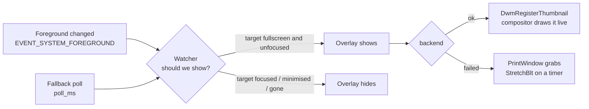

# SidePeek

**English** · [简体中文](README.zh-CN.md)

> Die, tab out, do something else — and still keep an eye on the respawn timer.

When you alt-tab away from a game, SidePeek floats a small window in the corner of your desktop showing a **live** view of the game. Switch back and it disappears instantly.

Not a stale screenshot that only appears on hover, and not a screen recording — it's the real, live picture, and it costs almost no CPU.

> **Demo GIF wanted.** A short `docs/demo.gif` would help a lot. Keep your desktop's private content out of frame.

---

## Why

Most games make you wait 5–60 seconds after dying. You tab out to do something, then start flicking back to check — because taskbar previews only show on hover and are often out of date.

SidePeek removes that friction: **leave the game and the picture appears in the corner; come back and it hides itself.**

## Features

- **Zero configuration** — tab out of a fullscreen / borderless game once and it remembers that window and starts watching. No process names to type.
- **Two renderers, automatic fallback**
  - `dwm` — asks the Desktop Window Manager for a live thumbnail. Drawn by the compositor, so **CPU usage is essentially zero** and the frame rate matches the game.
  - `capture` — periodic `PrintWindow` grabs, for the windows that refuse a thumbnail.
- **Event driven** — hooks `EVENT_SYSTEM_FOREGROUND` instead of busy-polling.
- **Drag / resize / remembered** — put it where you want, size it how you want; it survives restarts.
- **Click to return** — one click on the thumbnail jumps back into the game.
- **Standard library only** — just `ctypes`. No third-party packages.
- **Lockable target** — `Ctrl+Alt+L` pins the current window when auto-detection gets it wrong.

## Quick start

Requires Windows 10 / 11 and Python 3.9+ (64-bit).

```bash
git clone https://github.com/<your-name>/sidepeek.git
cd sidepeek
python run.py
```

Want it without a console window:

```bat
pythonw run.py
```

Nothing happens after launch — that's expected. **Focus your game, then tab out**, and the thumbnail appears.

### Build a standalone exe

```bat
build_exe.bat
```

Output: `dist\SidePeek.exe`. Double-click to run; no Python needed.

## Usage

### Three ways to pick the target

| Way | How | When |
| --- | --- | --- |
| Auto-detect (default) | Just run it, then focus the game once | Fullscreen / borderless-windowed games |
| Process allowlist | `python run.py --target cs2.exe`, or `peek.targets` in `config.json` | Known games, multiple clients, windowed games |
| Manual lock | Press `Ctrl+Alt+L` while the game is focused | Exclusive fullscreen, or when auto-detect misses |

### Hotkeys

| Hotkey | Action |
| --- | --- |
| `Ctrl+Alt+G` | Pause / resume watching |
| `Ctrl+Alt+L` | Lock the current foreground window as the target |
| `Ctrl+Alt+Q` | Quit |

All three are configurable; set one to an empty string to disable it.

### On the thumbnail

- Drag to move (hold left button)
- Drag the bottom-right corner to resize
- Click to jump back into the game
- Right-click for a menu: return to game / clear target / pause / quit

### Diagnostics

When something feels off, run the self-test first — it picks a real window and exercises both renderers:

```bash
python run.py --list          # visible windows, and whether each looks fullscreen
python run.py --self-test     # is a DWM thumbnail / a frame grab possible?
python run.py --screenshot out.png --target cs2.exe   # save one frame and look at it
```

Sample `--self-test` output:

```
dwm composition : True
test target: cs2.exe | Counter-Strike 2
  window        : created
  dwm thumbnail : OK  size=(2560, 1440)
  capture       : OK  (2560, 1440) via printwindow-full
result: ready - at least one backend works on this machine
```

## Configuration

`config.json` is created next to the program on first run (`config.example.json` holds the defaults — copy and rename it if you prefer).

| Key | Default | Meaning |
| --- | --- | --- |
| `width` / `height` | `480` / `270` | Thumbnail size in physical pixels |
| `backend` | `"auto"` | `auto` / `dwm` / `capture` |
| `anchor` | `"bottom-right"` | `top-left` / `top-right` / `bottom-left` / `bottom-right` / `custom` |
| `margin` | `24` | Distance from the screen edge |
| `padding` | `6` | Gap between the frame and the picture |
| `opacity` | `100` | Picture opacity (DWM backend) |
| `caption` | `true` | Show the bottom bar with process name and elapsed time |
| `click_to_focus` | `true` | Click the thumbnail to return to the game |
| `hide_when_minimized` | `true` | Hide while the game is minimised (it usually stops rendering) |
| `hide_when_hovered` | `false` | Hide when the cursor is over the thumbnail |
| `fps` | `20` | Frame rate of the `capture` backend |
| `targets` | `[]` | Process allowlist, e.g. `["cs2.exe", "dota2.exe"]`; empty means auto-detect |
| `auto_detect_fullscreen` | `true` | Treat monitor-filling windows as games |
| `ignore` | see file | Processes that are never a game (browsers, editors, the shell, ...) |
| `poll_ms` | `300` | Fallback poll interval in ms |
| `hotkey_*` | see file | Global hotkeys |

Changes take effect on restart; position and size are written back on exit.

## How it works



Three layers; one file per concern under `sidepeek/`:

| File | Responsibility |
| --- | --- |
| `win32.py` | ctypes bindings for user32 / gdi32 / dwmapi, with full argtypes |
| `capture.py` | `PrintWindow` into a DIB, plus the "did we just grab a black frame?" check |
| `overlay.py` | Frameless topmost window: both render modes, drag/resize, painting, context menu |
| `watcher.py` | State machine: remember the last fullscreen window, decide show or hide |
| `config.py` | JSON config load/save with defaults merging |
| `app.py` | Message loop, global hotkeys, foreground hook, diagnostics |

### Why the DWM thumbnail comes first

`DwmRegisterThumbnail` is the same mechanism behind the system Alt+Tab preview: you attach one window's picture to a rectangle of another window and the compositor draws it on the GPU. We only update that rectangle — **no pixel reads, no copies, no scaling** — so a 200 fps game doesn't notice we exist.

The trade-off: DWM only works for windows that DWM itself composites. True exclusive fullscreen (DirectX exclusive) bypasses the compositor and the thumbnail comes out black — see *Known limitations*.

### Why a capture backend is still needed

A few windows (some GPU-accelerated UWP apps, older games, anything DWM declines) give no thumbnail. Then SidePeek falls back to `PrintWindow(PW_RENDERFULLCONTENT)` on a timer. That reads the DWM redirection surface, so it still works while the window sits in the background. Each grab is sampled for "is this all black?", and if it is, the last resort is a plain `BitBlt`.

## Known limitations

- **Exclusive fullscreen is unsupported.** Tabbing out minimises the game and rendering stops — no capture API can help. Use *Fullscreen Windowed* / *Borderless* instead, which is what most competitive games recommend anyway (and it makes alt-tabbing faster).
- **DRM / HDCP protected content** captures as black.
- **HDR content** may look colour-shifted in the capture backend (it reads the SDR surface).
- **Windows only** — the implementation is deeply tied to Win32 and DWM.
- **Anti-cheat.** SidePeek does not inject into processes and never touches game memory; it only calls system-level window and screen-capture APIs. That said, games' terms of service vary in how they treat third-party tools — check yours. Use at your own risk.

## FAQ

**The thumbnail doesn't appear when I tab out.**
Run `python run.py --self-test` first. If both backends report OK but nothing shows, the target probably wasn't recognised — use `--target yourgame.exe` or press `Ctrl+Alt+L`.

**The thumbnail is black or frozen.**
That's the DWM limitation (usually exclusive fullscreen). Switch the game to borderless windowed.

**The aspect ratio looks wrong.**
The picture is letterboxed to preserve its ratio. Set `width`/`height` close to the game's aspect ratio for a snug fit.

**Autostart on login?**
Press `Win+R`, type `shell:startup`, and drop a shortcut to `SidePeek.exe` in there (or to `pythonw run.py` if running from source).

**Will anti-cheat flag it?**
It only *reads the screen* — it never goes inside the game process. Most anti-cheat systems won't care, but please respect your game's ToS.

## Roadmap

- [ ] OCR the respawn countdown and beep when it's up (then you don't even need to look)
- [ ] Tray icon, so it can be quit without a console
- [ ] Watch several games at once
- [ ] In-overlay hotkeys (zoom / switch backend)
- [ ] Cheaper capture via DXGI Desktop Duplication

## Contributing

Issues and PRs are welcome. Before changing code, run `python run.py --self-test` to confirm both backends work on your machine, and `python -m compileall sidepeek` before committing.

## License

[MIT](LICENSE)
