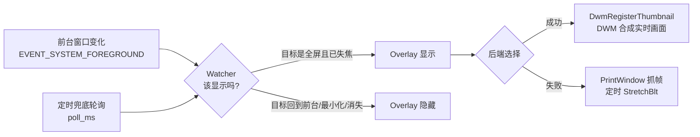

# SidePeek · 游戏后台小窗

[](https://github.com/markliu12/sidepeek/actions/workflows/ci.yml)

[English](README.md) · **简体中文**

> 死了以后切出去刷点别的，别再反复按 Alt+Tab 看复活了没有。

当你从游戏切走，SidePeek 会自动在桌面右下角浮出一个小窗，**实时**显示游戏画面；切回游戏，它立刻消失。

不是悬停才出现的静态截图，也不是录屏——是真的实时画面，而且几乎不占 CPU。

> **演示图待补充**：欢迎提 PR 贡献一张自己录的 GIF（`docs/demo.gif`），注意别把桌面上的私人内容拍进去。

---

## 为什么需要它

多数游戏死后有 5~60 秒的复活等待。这段时间你会切出去看点东西，然后开始反复切回来确认——因为任务栏预览必须把鼠标移上去才出现，而且往往是一张过期的缩略图。

SidePeek 把这层摩擦去掉：**你一离开游戏，画面就自动出现在屏幕角落；你一回去，它就自动收起。**

## 特性

- **零配置可用**：从全屏 / 无边框窗口的游戏切出去，它就自动记住这个窗口并开始监视，不需要填任何进程名
- **两种渲染后端，自动降级**
  - `dwm`：调用桌面窗口管理器的缩略图 API，画面由 DWM 合成，**CPU 占用几乎为 0**，帧率和游戏一致
  - `capture`：`PrintWindow` 定时抓帧，兼容那些拒绝 DWM 缩略图的窗口
- **状态驱动**：挂钩系统的前台窗口切换事件（`EVENT_SYSTEM_FOREGROUND`），不是死循环轮询
- **可拖拽 / 可缩放 / 位置大小记忆**：拖到哪、拉多大，下次启动还是那样
- **点击即回游戏**：点一下小窗就直接切回游戏窗口
- **纯标准库**：只用了 `ctypes`，没有任何第三方依赖
- **目标可锁定**：`Ctrl+Alt+L` 把当前窗口钉成监视目标，应对自动识别不准的情况

## 快速开始

要求：Windows 10 / 11，Python 3.9+（64 位）

```bash
git clone https://github.com/<your-name>/sidepeek.git
cd sidepeek
python run.py
```

不想留控制台窗口：

```bat
pythonw run.py
```

启动后什么都不会发生——这是正常的。**切到游戏，再切出去**，小窗就出现了。

### 打包成 exe

```bat
build_exe.bat
```

产物在 `dist\SidePeek.exe`，双击即用，不需要装 Python。

## 使用

### 三种指定目标的方式

| 方式 | 做法 | 适用场景 |
| --- | --- | --- |
| 自动识别（默认） | 直接运行，切一次游戏即可 | 全屏 / 无边框窗口模式的游戏 |
| 进程名白名单 | `python run.py --target cs2.exe`，或写进 `config.json` 的 `targets` | 已知游戏、多开、窗口化游戏 |
| 手动锁定 | 游戏在前台时按 `Ctrl+Alt+L` | 独占全屏、或自动识别失效时 |

### 热键

| 热键 | 作用 |
| --- | --- |
| `Ctrl+Alt+G` | 暂停 / 恢复监视 |
| `Ctrl+Alt+L` | 把当前前台窗口锁定为监视目标 |
| `Ctrl+Alt+Q` | 退出 |

热键可在 `config.json` 里改，配成空字符串即禁用。

### 小窗上的操作

- 拖动：按住左键拖走
- 缩放：拖右下角
- 点一下：切回游戏
- 右键：菜单（回到游戏 / 清除目标 / 暂停监视 / 退出）

### 诊断工具

怀疑不好使的时候，先跑自检——它会挑一个真实窗口，把两条渲染链路都试一遍：

```bash
python run.py --list          # 列出当前可见窗口、是否被判为全屏
python run.py --self-test     # 检测 DWM 缩略图 / 抓帧是否可用
python run.py --screenshot out.png --target cs2.exe   # 存一帧看看能不能抓到画面
```

`--self-test` 输出示例：

```
dwm composition : True
test target: cs2.exe | Counter-Strike 2
  window        : created
  dwm thumbnail : OK  size=(2560, 1440)
  capture       : OK  (2560, 1440) via printwindow-full
result: ready - at least one backend works on this machine
```

## 配置

首次运行会在程序目录生成 `config.json`（`config.example.json` 是默认值样例，可直接复制改名）。

| 键 | 默认值 | 说明 |
| --- | --- | --- |
| `width` / `height` | `480` / `270` | 小窗尺寸（物理像素，DPI 缩放后仍按实际像素算） |
| `backend` | `"auto"` | `auto` / `dwm` / `capture` |
| `anchor` | `"bottom-right"` | `top-left` / `top-right` / `bottom-left` / `bottom-right` / `custom` |
| `margin` | `24` | 距屏幕边缘的距离 |
| `padding` | `6` | 画面与边框的内边距 |
| `opacity` | `100` | 画面不透明度（DWM 后端） |
| `caption` | `true` | 是否显示底部信息条（进程名 + 后台时长） |
| `click_to_focus` | `true` | 点击小窗切回游戏 |
| `hide_when_minimized` | `true` | 游戏最小化时隐藏（最小化的窗口通常不再渲染） |
| `hide_when_hovered` | `false` | 鼠标移到小窗上就隐藏，避免挡操作 |
| `fps` | `20` | `capture` 后端的帧率 |
| `targets` | `[]` | 进程名白名单，如 `["cs2.exe", "dota2.exe"]`；空表示自动识别 |
| `auto_detect_fullscreen` | `true` | 自动把覆盖整个显示器的窗口当成游戏 |
| `ignore` | 见文件 | 永不当作游戏的进程（浏览器、编辑器、桌面 shell 等） |
| `poll_ms` | `300` | 兜底轮询间隔（毫秒） |
| `hotkey_*` | 见文件 | 全局热键 |

改完配置重启程序生效（位置和尺寸会在退出时自动回写）。

## 工作原理



三层结构，`sidepeek/` 下每个文件对应一件事：

| 文件 | 职责 |
| --- | --- |
| `win32.py` | ctypes 绑定：user32 / gdi32 / dwmapi，带完整 argtypes |
| `capture.py` | `PrintWindow` 抓帧到 DIB，并做「是不是抓到黑屏」的校验 |
| `overlay.py` | 无边框置顶窗口：两种渲染模式、拖拽缩放、绘制、右键菜单 |
| `watcher.py` | 状态机：记住上一个全屏窗口，判断该显示还是该隐藏 |
| `config.py` | JSON 配置的读写与默认值合并 |
| `app.py` | 消息循环、全局热键、前台事件钩子、自检工具 |

### 为什么优先用 DWM 缩略图

`DwmRegisterThumbnail` 正是系统 Alt+Tab 预览用的那套机制：把一个窗口的画面「挂」到另一个窗口的指定矩形里，由桌面合成器在 GPU 上绘制。我们只负责更新目标矩形，**没有任何读像素、拷贝、缩放的开销**，所以游戏 200 帧它也不会拖累你。

代价是：DWM 只对**由 DWM 合成**的窗口有效。真·独占全屏（DirectX exclusive fullscreen）绕过了 DWM，缩略图会是黑的——这在下面「已知限制」里说明。

### 为什么还需要抓帧后端

少数窗口（部分 GPU 加速的 UWP 应用、某些老游戏、以及被 DWM 拒绝的窗口）拿不到缩略图。这时自动切到 `PrintWindow(PW_RENDERFULLCONTENT)` 定时抓帧，抓到的是 DWM 重定向表面，所以在后台也能取到画面。抓完会采样校验「是不是全黑」，黑屏就再退一步用 `BitBlt`。

## 已知限制

- **独占全屏（真全屏）不适用**：切出去后游戏窗口会被系统最小化，渲染停止，任何截屏手段都拿不到新画面。请在游戏里改用「无边框窗口 / 全屏窗口（Fullscreen Windowed / Borderless）」——这也是现在多数竞技游戏推荐的模式，Alt+Tab 更快。
- **受保护内容抓不到**：带 DRM/HDCP 保护的播放器和少数游戏会输出黑屏。
- **HDR 画面可能偏色**：抓帧后端拿到的是 SDR 转换后的表面。
- **只在 Windows 上工作**：实现深度依赖 Win32 / DWM。
- **反作弊**：SidePeek 不注入进程、不读写游戏内存，只调用系统级窗口与截屏 API。但不同游戏的服务条款对第三方工具的态度不一致，请自行确认，风险自负。

## 常见问题

**切出去小窗没出来？**
先跑 `python run.py --self-test`。若两侧都 OK 但实际不出现，多半是目标没被识别：用 `--target 游戏.exe` 或按 `Ctrl+Alt+L` 锁定。

**小窗里是黑屏或定格画面？**
说明命中了 DWM 缩略图的限制（多半是独占全屏），把游戏改成无边框窗口模式。

**画面比例不对？**
小窗会按画面比例做等比缩放（留黑边），把 `width`/`height` 调成接近游戏的宽高比即可。

**想开机自启？**
`Win+R` 输入 `shell:startup`，把 `SidePeek.exe` 的快捷方式丢进去（源码运行则创建 `pythonw run.py` 的快捷方式）。

**会不会被游戏当成外挂？**
它只做「读屏幕」，不碰游戏进程内部。绝大多数反作弊不会因此误判，但请遵守你游戏的服务条款。

## Roadmap

- [ ] 复活倒计时识别（OCR 读小窗里的数字）+ 到点响一声，彻底不用看
- [ ] 托盘图标，不开控制台也能退出
- [ ] 多游戏同时监视
- [ ] 小窗内快捷键（放大 / 切后端）
- [ ] 更省电的抓帧（DXGI Desktop Duplication）

## 贡献

Issue / PR 都欢迎。改代码前建议先跑一遍 `python run.py --self-test` 确认你的环境两条链路都通；提交前跑：

```bash
python -m compileall -q sidepeek run.py
python -m unittest discover -s tests -t .    # 标准库 unittest，无需额外依赖
```

## License

[MIT](LICENSE)
