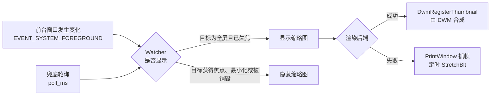

# SidePeek · 游戏后台实时缩略图

[](https://github.com/markliu12/sidepeek/actions/workflows/ci.yml)

[English](README.md) · **简体中文**

> **等复活的那半分钟，别再反复 Alt+Tab —— 画面就留在桌角。**

SidePeek 是一个 Windows 桌面工具。当游戏窗口失去前台焦点时，它在屏幕角落显示该窗口的实时缩略图；当游戏窗口重新获得前台焦点时，缩略图自动隐藏。

---

## 概述

多数联机游戏在角色死亡后设有 5 至 60 秒的复活等待时间。用户通常在此期间切换到其他窗口。系统任务栏预览需要将指针悬停于对应项上方才会显示，且显示的图像可能已经过期，因此确认复活是否完成需要反复切换窗口。

SidePeek 消除这一交互成本：游戏窗口失去前台状态时，缩略图出现在桌面角落；游戏窗口重新获得前台状态时，缩略图立即移除。

缩略图是对游戏窗口的实时渲染，而非定时截图或屏幕录制。在默认配置下，画面由桌面窗口管理器（DWM）合成，对 CPU 的占用可忽略不计，且与游戏帧率一致。

## 运行要求

- Windows 10 或 Windows 11，64 位
- 从源码运行时需要 Python 3.9 或更高版本
- 不依赖任何第三方 Python 包

## 安装

### 从源码运行

```bash
git clone https://github.com/<user>/sidepeek.git
cd sidepeek
python run.py
```

如需隐藏控制台窗口，请使用 `pythonw run.py`。

首次启动时，程序会在自身目录下生成 `config.json`，其默认值见[配置](#配置)一节。

### 从发布版本获取

`SidePeek.exe` 会随每个[发布版本](https://github.com/markliu12/sidepeek/releases)提供，无需安装。各版本之间的变更记录见 [CHANGELOG.md](CHANGELOG.md)。

### 构建可执行文件

```bat
build_exe.bat
```

产物为 `dist\SidePeek.exe`，约 8 MB，运行时不依赖 Python 环境。图标与 Windows 版本资源分别取自 `assets/sidepeek.ico` 与 `version_info.txt`；若环境中缺少 PyInstaller，脚本会自动安装。首次启动时会在可执行文件同目录下生成 `config.json`。

推送形如 `v*` 的标签会触发 `.github/workflows/build.yml`：构建可执行文件、校验版本资源是否存在，并同时作为工作流构件与发布附件上传。

## 行为说明

### 监视目标的确定

监视目标按以下顺序确定：

1. **锁定目标。** 通过 `Ctrl+Alt+L` 显式锁定的窗口在本次会话内优先。
2. **进程白名单。** 若 `peek.targets` 非空，则采用最近获得过焦点的匹配窗口；若此类窗口从未获得焦点，则采用面积最大的可见匹配窗口。
3. **自动检测。** 若 `peek.targets` 为空，则前台窗口覆盖某个显示器时即被记录为目标。若尚未记录任何窗口，则接管覆盖显示器的最大可见窗口，从而使程序在用户已经切换到其他窗口之后启动时仍然有效。

`peek.ignore` 中列出的进程名不会被识别为游戏。

### 显示条件

仅当以下条件全部满足时显示缩略图：

- 目标窗口存在且有效；
- 目标窗口不是前台窗口；
- 目标窗口可见；
- 目标窗口未最小化，或 `hide_when_minimized` 为 `false`；
- 指针不在缩略图区域内，或 `hide_when_hovered` 为 `false`。

已被销毁的目标窗口会从内部状态中清除。

通过**监视窗口**菜单选中的窗口与按 `Ctrl+Alt+L` 锁定等价；选中**自动**即解除锁定。

### 全屏判定

满足以下任一条件时，窗口被视为全屏：

- 覆盖其所在显示器的 98% 以上，此时亦覆盖任务栏区域；或
- 覆盖其所在显示器的 90% 以上，且未最大化。最大化窗口仅填充工作区，约占显示器的 96%，若无此排除条件将与全屏应用无法区分。

通过指定 `peek.targets` 或使用 `Ctrl+Alt+L` 锁定窗口可以绕过自动判定。

### 窗口交互

缩略图为无边框、置顶窗口，且不会被指针激活。按住鼠标左键可拖动，拖动右下角可调整尺寸；尺寸与位置在退出时写入 `config.json`。最小尺寸为 160 × 90 像素。单击可将焦点返回游戏窗口，右键打开上下文菜单。

宽度由用户决定。启用 `fit_aspect`（默认开启）时，高度根据游戏画面的宽高比推导，因此 16:9、16:10、21:9 与 4:3 的游戏都能填满画面区而不产生黑边；初始高度 304 对应 16:9，首次显示游戏时会被校正。关闭 `fit_aspect` 将固定窗口形状，此时画面按比例缩放并留边。

拖动右下角调整尺寸会**自动关闭** `fit_aspect`：手动选定的尺寸不应在缩略图下次出现时被覆盖。两个上下文菜单中的**按画面比例自适应**可重新开启。

### 通知区域

SidePeek 在运行期间于通知区域显示一个图标。缩略图隐藏时该图标依然存在，因此在没有控制台窗口的情况下，这是访问程序的可靠入口。

- **右键**打开菜单：回到游戏窗口、切换监视窗口、切换按画面比例自适应、暂停或恢复监视、切换开机自动启动、退出。
- **监视窗口**子菜单列出所有可监视的窗口，按窗口面积从大到小排列。选中某一项即锁定该窗口，效果与 `Ctrl+Alt+L` 相同；选中**自动**则解除锁定，回到自动识别。多开游戏时应当用这里切换：不需要记热键，也能一眼看到有哪些可选。
- **双击**暂停或恢复监视。
- 工具提示显示当前状态（`SidePeek — 监视中` 或 `SidePeek — 已暂停`）。

资源管理器重启后，图标会被自动重新添加。

### 单实例

命名互斥体保证同时只有一个副本在运行。再次启动不会打开第二个窗口，也不会夺走第一个副本的热键：正在运行的副本会弹出一个气泡指向自己的通知区域图标，新进程以退出码 0 结束。命令行诊断不受此限制，因此程序运行期间仍可使用 `--list`、`--self-test` 与 `--screenshot`。

## 命令行参数

```bash
python run.py [--config PATH] [--backend {auto,dwm,capture}]
              [--width N] [--height N] [--target EXE]
              [--list] [--self-test] [--screenshot PATH]
```

| 参数 | 说明 |
| --- | --- |
| `--config PATH` | 指定配置文件路径。默认为程序目录下的 `config.json`。 |
| `--backend` | 强制指定渲染后端。`auto` 优先使用 `dwm`，失败时回退至 `capture`。 |
| `--width`、`--height` | 覆盖本次会话的缩略图尺寸。 |
| `--target EXE` | 仅监视指定的进程名，可重复指定。 |
| `--list` | 输出当前可见的顶层窗口列表后退出。 |
| `--self-test` | 针对一个真实窗口测试两种渲染后端后退出。 |
| `--screenshot PATH` | 将一帧画面保存为 PNG 文件后退出。 |

通过 `--width`、`--height`、`--backend` 与 `--target` 指定的值仅对当次运行生效，不会写入 `config.json`。

## 热键

| 热键 | 功能 |
| --- | --- |
| `Ctrl+Alt+G` | 暂停或恢复监视。 |
| `Ctrl+Alt+L` | 将前台窗口锁定为监视目标。 |
| `Ctrl+Alt+Q` | 退出程序。 |

组合键可通过 `hotkey_toggle`、`hotkey_lock` 与 `hotkey_quit` 配置。若组合键已被其他应用程序注册，程序将在缺少该热键的情况下继续运行，并弹出通知区域气泡说明；对应功能仍可从通知区域菜单使用。

## 诊断工具

自检命令会针对当前桌面上的一个真实窗口测试两种渲染后端，并分别报告结果：

```bash
python run.py --list
python run.py --self-test
python run.py --screenshot frame.png --target cs2.exe
```

输出示例：

```
dwm composition : True
test target: cs2.exe | Counter-Strike 2
  window        : created
  dwm thumbnail : OK  size=(2560, 1440)
  capture       : OK  (2560, 1440) via printwindow-full
result: ready - at least one backend works on this machine
```

在提交缺陷报告之前，建议先执行自检。

### 日志文件

打包版本没有控制台，因此所有原本输出到控制台的内容同时写入：

```
%LOCALAPPDATA%\SidePeek\sidepeek.log
```

文件超过 512 KB 时保留一份上一代 `sidepeek.log.1`。未捕获的异常同样写入该文件并弹出提示框，因此窗口模式下崩溃不再悄无声息。提交问题时请附上此文件。

## 配置

配置文件采用 JSON 格式。缺失的键使用默认值，未知的键被忽略。

| 键 | 默认值 | 说明 |
| --- | --- | --- |
| `width`、`height` | `492`、`304` | 缩略图窗口尺寸，单位为物理像素，最小为 160 × 90。扣除边框内边距与信息条后，画面区为 480 × 270（16:9），因此 16:9 的游戏不会出现黑边。 |
| `backend` | `"auto"` | 取值 `auto`、`dwm` 或 `capture`。 |
| `anchor` | `"bottom-right"` | 取值 `top-left`、`top-right`、`bottom-left`、`bottom-right` 或 `custom`。 |
| `margin` | `24` | 与显示器边缘的距离，单位为像素。 |
| `pos` | `[0, 0]` | `anchor` 为 `custom` 时使用的位置。 |
| `padding` | `6` | 边框与画面之间的间距。 |
| `opacity` | `100` | 画面不透明度，取值 10 至 100，作用于 `dwm` 后端。 |
| `caption` | `true` | 显示底部信息条，内容为进程名与后台停留时间。 |
| `fit_aspect` | `true` | 根据游戏画面的宽高比推导窗口高度，使画面填满而不留黑边。手动拖动调整尺寸后自动关闭。 |
| `click_to_focus` | `true` | 单击缩略图时将焦点返回游戏。 |
| `hide_when_minimized` | `true` | 游戏最小化期间隐藏缩略图。 |
| `hide_when_hovered` | `false` | 指针位于缩略图上方时隐藏。 |
| `fps` | `20` | `capture` 后端的帧率，取值 1 至 60。 |
| `targets` | `[]` | 监视的进程名，例如 `["cs2.exe", "dota2.exe"]`。为空时启用自动检测。 |
| `auto_detect_fullscreen` | `true` | 将覆盖显示器的窗口识别为游戏。 |
| `ignore` | 见文件 | 永不识别为游戏的进程名。 |
| `poll_ms` | `300` | 兜底轮询的间隔，单位为毫秒。 |
| `hotkey_toggle` | `"ctrl+alt+g"` | 暂停或恢复监视。 |
| `hotkey_lock` | `"ctrl+alt+l"` | 将前台窗口锁定为监视目标。 |
| `hotkey_quit` | `"ctrl+alt+q"` | 退出程序。 |
| `show_in_taskbar` | `false` | 在任务栏中显示缩略图窗口。 |

热键可通过赋值为空字符串禁用。配置修改在程序重启后生效。

## 实现原理



实现划分为以下模块：

| 文件 | 职责 |
| --- | --- |
| `win32.py` | user32、gdi32 与 dwmapi 的 `ctypes` 绑定，所用函数均显式声明 `argtypes` 与 `restype`。 |
| `capture.py` | 通过 `PrintWindow` 抓帧至 DIB，并对结果进行有效性校验。 |
| `overlay.py` | 无边框顶层窗口、两种渲染模式、绘制、拖动与缩放、上下文菜单。 |
| `watcher.py` | 目标确定与显示判定。 |
| `config.py` | 配置的读取、合并与回写。 |
| `app.py` | 消息循环、全局热键、前台事件钩子与诊断工具。 |
| `png.py` | 供诊断工具使用的极简 PNG 编码器。 |
| `diag.py` | 日志文件与未捕获异常的处理。 |
| `instance.py` | 单实例锁，以及再次启动时对运行中副本的通知。 |
| `autostart.py` | 开机自启开关，读写当前用户的 `Run` 项。 |

### 渲染后端

`dwm` 后端通过 `DwmRegisterThumbnail` 注册缩略图，其机制与系统 Alt+Tab 预览相同。合成器在 GPU 上将源窗口渲染至目标窗口的指定矩形内。本进程仅更新该矩形，不读取、不复制、不缩放任何像素数据。

该后端要求源窗口由桌面窗口管理器合成。独占全屏应用绕过合成器，因此缩略图为空。

`capture` 后端通过 `PrintWindow(PW_RENDERFULLCONTENT)` 获取画面，该接口读取 DWM 的重定向表面，因此在窗口处于后台时同样有效。每帧均进行采样，以检测结果是否为全黑；若校验失败，则尝试直接从窗口设备上下文执行 `BitBlt`。该后端的 CPU 占用与配置的帧率成正比，仅在 `dwm` 后端不可用时启用。

## 测试

```bash
python -m compileall -q sidepeek run.py
python -m unittest discover -s tests -t .
```

测试使用标准库 `unittest`，无需安装额外依赖。测试中对 Win32 接口进行了模拟，因此在无交互式桌面会话的环境中亦可运行。持续集成在 Python 3.9、3.11 与 3.13 上执行该测试集。

## 已知限制

- **不支持独占全屏。** 独占全屏应用失去焦点后，其窗口被系统最小化且渲染停止，任何截取方式均无法获得实时画面。需要使用全屏窗口（Fullscreen Windowed）或无边框窗口（Borderless）模式。该模式亦为多数竞技游戏推荐使用的模式，可降低任务切换的开销。
- **受保护内容无法截取。** 受 DRM 或 HDCP 保护的窗口输出为黑屏。
- **HDR 内容可能显示为错误色彩。** `capture` 后端读取的是色调映射后的 SDR 表面。
- **仅支持 Windows。** 实现依赖 Win32 与桌面窗口管理器。
- **反作弊相关说明。** SidePeek 不向其他进程注入代码，不读写游戏内存，仅调用公开的窗口与屏幕截取接口。各游戏与反作弊系统对第三方软件的策略不同，遵守相应服务条款的责任由用户承担。

## 故障排查

**从游戏切换出来后缩略图未出现。**
执行 `python run.py --self-test`。若两种后端均报告成功，通常是目标窗口未被识别：通过 `--target` 或 `peek.targets` 显式指定，或在游戏处于前台时按 `Ctrl+Alt+L` 锁定。

**缩略图为黑屏或定格画面，通常出现在机器睡眠唤醒之后。**
唤醒时会重建缩略图，画面应在极短时间内恢复。若未恢复，源窗口很可能处于独占全屏模式，`dwm` 后端无法合成。请将游戏切换至全屏窗口或无边框窗口模式。

**画面未填满缩略图。**
画面按比例缩放并留边。在上下文菜单中开启**按画面比例自适应**，由游戏画面推导高度；或将 `width` 与 `height` 设置为接近游戏的宽高比以减小留边。

**在高 DPI 显示器上缩略图尺寸不合适。**
尺寸以物理像素为单位，请根据显示缩放比例调整 `width` 与 `height`。

**再次启动程序似乎没有任何反应。**
同一时间只允许一个副本运行。正在运行的副本会弹出气泡，指向自己的通知区域图标。

**程序表现异常，但没有控制台可看。**
打开 `%LOCALAPPDATA%\SidePeek\sidepeek.log`。启动、目标切换、热键冲突、唤醒处理与未捕获异常都会记录在其中。

**如何设置为开机启动？**
右键通知区域图标，勾选**开机自动启动**。该操作写入当前用户的 `Run` 项，无需管理员权限。将快捷方式放入 `shell:startup` 打开的目录同样有效。

## 演示录屏

本仓库暂未包含演示录屏。欢迎提交位于 `docs/demo.gif` 的短录屏；录制时请确保画面范围内不包含无关的桌面内容。

## 后续计划

- [ ] 通过缩略图识别复活倒计时，并在倒计时结束时发出提示
- [x] 系统托盘图标（右键退出）
- [ ] 同时监视多个游戏
- [ ] 通过 DXGI Desktop Duplication 降低抓帧开销
- [ ] 根据显示器 DPI 自动换算缩略图尺寸

## 参与贡献

欢迎提交 Issue 与 Pull Request。提交修改前，请先执行自检以确认两种后端在本机均可工作，并执行[测试](#测试)一节中列出的命令。

## 许可证

[MIT](LICENSE)
